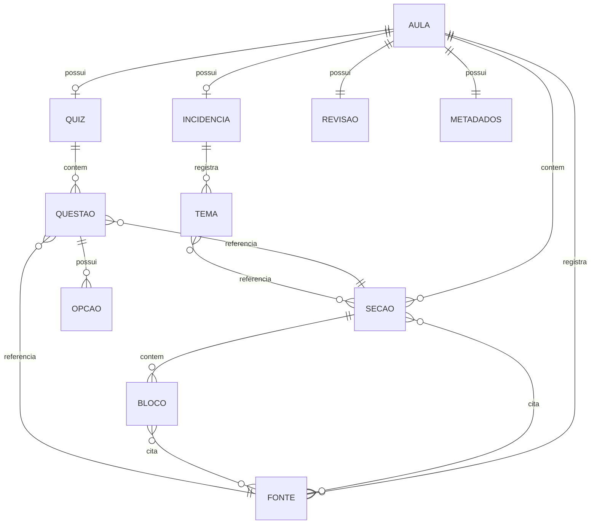

# Modelo de dados do Hermes

O modelo descreve uma **aula** como um agregado editorial: um documento JSON autocontido, com fontes, seções, blocos, quiz, incidência, revisão e metadados. A fonte da verdade é [`schema/aula.schema.json`](../schema/aula.schema.json); este documento explica as entidades, as chaves e as regras que o schema sozinho não expressa.

## Visão geral



A aula é a raiz. Fontes, seções, quiz, incidência, revisão e metadados são composições contidas no mesmo documento. Não há chave estrangeira de banco: a integridade é verificada por `validate.py` a partir dos identificadores.

## Chaves e identificadores

| Entidade | Chave local | Formato | Observação |
|---|---|---|---|
| Aula | `id` | `kebab-case` | Único no acervo. |
| Fonte | `fontes[].id` | `kebab-case` | Referenciada por seções, blocos e questões. |
| Seção | `secoes[].id` | `kebab-case` | Usada em âncoras, incidência e quiz. |
| Bloco | `secoes[].blocos[].id` | `kebab-case` | Único em toda a aula. |
| Questão | `quiz.questoes[].id` | `kebab-case` | Única no quiz. |
| Alternativa | sem id | — | Posição no array preserva a ordem. |
| Tema de incidência | `nome` | texto | Único por incidência. |

Um id é **local à aula**, não global. Isso permite copiar uma aula sem colisões. Quando várias aulas forem agregadas, use a tupla `(aula.id, entidade, id)` como chave composta.

## Dicionário de dados

### Raiz

| Campo | Tipo | Obrigatório | Regras |
|---|---|---:|---|
| `schema_version` | string | sim | `const` igual a `1.0.0`. |
| `id` | string | sim | `kebab-case`, 2–100 caracteres. |
| `materia` | string | sim | Não vazia. |
| `numero` | integer | sim | 0–999. |
| `titulo` | string | sim | Não vazio. |
| `resumo` | string | sim | 20–800 caracteres. |
| `status` | enum | sim | `rascunho`, `revisao`, `publicado`, `arquivado`. |
| `idioma` | string | sim | BCP-47, como `pt-BR`. |
| `tags` | string[] | sim | 1–30; sem duplicatas. |
| `fontes` | fonte[] | sim | 1 ou mais. |
| `secoes` | secao[] | sim | 1 ou mais; numeração sequencial. |
| `quiz` | quiz | não | 4–8 questões quando presente. |
| `incidencia` | incidencia | não | `temas` pode ser vazio. |
| `revisao` | revisao | sim | Status, próxima data e ritual. |
| `metadados` | metadados | sim | Versão, datas, autoria e licença. |
| `notas` | string | não | Até 4.000 caracteres. |

### `fonte`

| Campo | Tipo | Obrigatório | Regras |
|---|---|---:|---|
| `id` | string | sim | `kebab-case`. |
| `tipo` | enum | sim | `livro`, `norma`, `curso`, `artigo`, `site`, `video`, `outro`. |
| `titulo` | string | sim | Não vazio. |
| `detalhes` | string | não | Até 500 caracteres. |
| `ano` | integer | não | 1000–9999. |
| `url` | string | não | URI absoluta. |

### `secao`

| Campo | Tipo | Obrigatório | Regras |
|---|---|---:|---|
| `id` | string | sim | `kebab-case`. |
| `numero` | integer | sim | 1–100; igual à posição no array. |
| `titulo` | string | sim | Não vazio; não pode ser “Questões comentadas” ou “Gabarito final”. |
| `subtitulo` | string | não | Não vazio. |
| `fontes` | string[] | não | 1 ou mais ids de fonte. |
| `blocos` | bloco[] | sim | 1 ou mais. |

### `bloco`

Todo bloco tem `tipo` e `id`; `fontes` é opcional. O discriminador é `tipo`:

| Tipo | Campos obrigatórios além de `tipo`/`id` | Campos opcionais |
|---|---|---|
| `paragrafo` | `texto` | `titulo`, `fontes` |
| `topico` | `texto` | `fontes` |
| `lista` | `itens` | `titulo`, `ordenada`, `fontes` |
| `tabela` | `colunas`, `linhas` | `titulo`, `fontes` |
| `destaque` | `nivel`, `texto` | `titulo`, `fontes` |
| `gotcha` | `texto` | `titulo`, `fontes` |
| `mnemonico` | `texto` | `titulo`, `fontes` |
| `exemplo` | `texto` | `titulo`, `fontes` |

### `quiz` e `questao`

| Campo | Tipo | Obrigatório | Regras |
|---|---|---:|---|
| `quiz.id` | string | sim | `kebab-case`. |
| `quiz.titulo` | string | não | Não vazio. |
| `quiz.instrucoes` | string | sim | Não vazio. |
| `quiz.questoes` | questao[] | sim | 4–8. |
| `questao.id` | string | sim | `kebab-case`. |
| `questao.enunciado` | string | sim | Não vazio. |
| `questao.opcoes` | opcao[] | sim | Exatamente 4. |
| `questao.secao_id` | string | sim | Seção existente. |
| `questao.fonte_id` | string | sim | Fonte existente. |
| `opcao.texto` | string | sim | Não vazio; único na questão. |
| `opcao.correta` | boolean | sim | Exatamente uma `true` por questão. |
| `opcao.explicacao` | string | sim | Não vazia, inclusive na correta. |

### `incidencia` e `temaIncidencia`

| Campo | Tipo | Obrigatório | Regras |
|---|---|---:|---|
| `incidencia.fonte` | string | sim | Não vazia. |
| `incidencia.atualizado_em` | date | sim | ISO `AAAA-MM-DD`. |
| `incidencia.temas` | tema[] | sim | Pode ser vazio. |
| `incidencia.observacao` | string | sim | Não vazia. |
| `tema.nome` | string | sim | Único por incidência. |
| `tema.peso` | integer | sim | 1–100; soma dos pesos = 100 quando houver temas. |
| `tema.secao_ids` | string[] | sim | 1 ou mais seções existentes. |

### `revisao`

| Campo | Tipo | Obrigatório | Regras |
|---|---|---:|---|
| `status` | enum | sim | `pendente`, `em_andamento`, `concluida`. |
| `ultima_em` | date | não | Não posterior a `proxima_em`. |
| `proxima_em` | date | sim | Não anterior a `metadados.atualizado_em`. |
| `ritual` | string[] | sim | 1 ou mais; sem duplicatas. |

### `metadados`

| Campo | Tipo | Obrigatório | Regras |
|---|---|---:|---|
| `versao` | string | sim | SemVer. |
| `criado_em` | date | sim | ISO. |
| `atualizado_em` | date | sim | Não anterior a `criado_em`. |
| `autores` | string[] | sim | 1 ou mais. |
| `revisores` | string[] | sim, pode ser vazio | Exigido não vazio para `publicado`. |
| `licenca` | string | sim | Identificador SPDX; `NOASSERTION` bloqueia publicação. |
| `origem` | string | sim | Não vazia. |
| `alteracoes` | string | sim | Não vazia. |

## Relacionamentos

```text
aula 1 ─── N fontes
aula 1 ─── N secoes
aula 1 ─── 0..1 quiz
aula 1 ─── 0..1 incidencia
aula 1 ─── 1 revisao
aula 1 ─── 1 metadados

secao 1 ─── N blocos
secao N ─── N fontes      (via fontes)
bloco N ─── N fontes      (via fontes)
quiz 1 ─── N questoes
questao N ─── 1 secao     (via secao_id)
questao N ─── 1 fonte     (via fonte_id)
questao 1 ─── 4 opcoes
incidencia 1 ─── N temas
tema N ─── N secoes       (via secao_ids)
```

As associações com fontes são muitos para muitos porque uma fonte pode sustentar vários blocos e um bloco pode citar várias fontes.

## Invariantes

O `validate.py` verifica as regras que o JSON Schema, sozinho, não garante:

1. **Numeração:** `secoes[i].numero == i + 1`.
2. **Ids únicos:** fontes, seções, blocos e questões não repetem id no documento.
3. **Referências de fonte:** seções, blocos, questões e incidência só apontam para fontes existentes.
4. **Referências de seção:** quiz e incidência só apontam para seções existentes.
5. **Tabelas:** cada linha tem o mesmo número de células que `colunas`.
6. **Quiz:** 2 a 5 alternativas, exatamente uma correta, explicação em todas, textos não duplicados.
7. **Incidência:** quando há temas, os pesos somam 100 e os nomes são únicos.
8. **Revisão:** `proxima_em >= atualizado_em` e `ultima_em <= proxima_em`.
9. **Cronologia:** `atualizado_em >= criado_em`.
10. **Publicação:** `status == "publicado"` exige revisor e licença diferente de `NOASSERTION`.
11. **Separação conteúdo/quiz:** títulos “Questões comentadas” e “Gabarito final” são proibidos nas seções.

## Estados e transições

| Estado | Significado | Pode virar |
|---|---|---|
| `rascunho` | Conteúdo em elaboração; precisa validar, mas ainda não foi revisado. | `revisao`, `arquivado` |
| `revisao` | Aguardando revisão de conteúdo, fontes ou acessibilidade. | `rascunho`, `publicado`, `arquivado` |
| `publicado` | Pronto para o acervo; exige revisor e licença definida. | `arquivado` |
| `arquivado` | Fora de circulação, preservado para histórico. | `rascunho` |

A transição para `publicado` é uma decisão editorial. O validador apenas impede que uma publicação declarada não tenha revisor ou licença.

## Versionamento e evolução

- **Mudança aditiva e compatível** (novo campo opcional, novo tipo de bloco): prefira minor (`1.1.0`) e atualize o validador e os testes. Foi o que aconteceu na `1.1.0`: `topico`, `paragrafo.titulo` e quiz com 2 a 5 alternativas.
- **Mudança incompatível** (remoção, renomeação, semântica alterada): major (`2.0.0`) e migração explícita.
- **Conteúdo da aula:** use `metadados.versao` SemVer; correção de texto é patch, nova seção é minor, mudança de recorte é major.

O schema usa `additionalProperties: false`. Um campo digitado errado deve falhar, não desaparecer silenciosamente.

## Projeção relacional opcional

Se as aulas forem importadas para um banco, uma projeção simples é:

```text
aula(id, materia, numero, titulo, resumo, status, idioma, schema_version,
     metadados_versao, criado_em, atualizado_em, licenca, origem)
fonte(aula_id, id, tipo, titulo, detalhes, ano, url)
secao(aula_id, id, numero, titulo, subtitulo)
bloco(aula_id, secao_id, id, tipo, titulo, texto, ordem, dados_json)
quiz(aula_id, id, titulo, instrucoes)
questao(aula_id, quiz_id, id, enunciado, secao_id, fonte_id)
opcao(aula_id, questao_id, ordem, texto, correta, explicacao)
incidencia_tema(aula_id, nome, peso)
incidencia_secao(aula_id, tema_nome, secao_id)
revisao(aula_id, status, ultima_em, proxima_em, ritual_json)
```

`dados_json` preserva os campos específicos do bloco sem criar uma tabela para cada tipo. A projeção é uma derivação; o JSON continua sendo a fonte da verdade.
